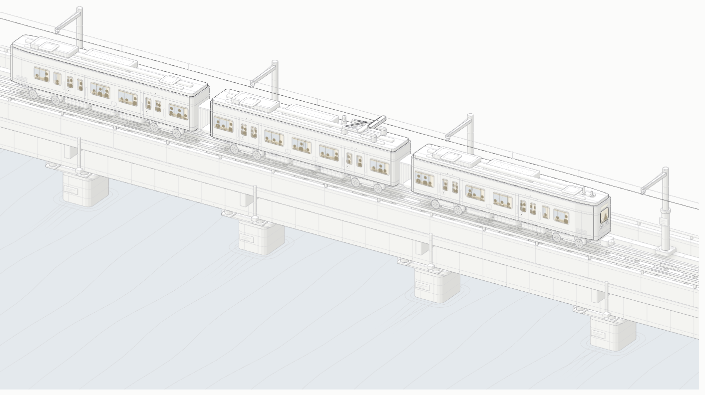

# isometric-metro

An interactive isometric figure: a three-car metro crossing a steel-girder
viaduct over a river. Every window is glazed and lit, and you can zoom into any
one of them — the train brakes to a stand while the camera rides it in.



## Run it

```sh
git clone https://github.com/abhicreates-dev/isometric-metro.git
cd isometric-metro
python3 -m http.server 8137
```

Then open <http://localhost:8137/metro-bridge-light.html> (or
`metro-bridge.html` for the dark build). The pages are standalone — no build
step, no dependencies, no network.

## Controls

| | |
|---|---|
| Click a window | Focus it. The train decelerates to a stand and the camera follows it in at 5.6×. |
| Scroll | Free zoom, up to 11× |
| Drag | Pan |
| ← / → | Step from window to window |
| Esc or `0` | Release; the train pulls away again |

## Build

The HTML is generated. Edit `build.mjs`, then:

```sh
node build.mjs            # dark
node build.mjs --light    # light
```

Node 18+ is enough; there is nothing to install.

## What it is drawn from

Everything is at a real scale of **1 unit = 10 cm**, so the dimensions are
honest rather than decorative:

- 19 m cars on bogies with a 2.3 m wheelbase and 84 cm wheels
- 1.44 m standard gauge on chaired rails over timber baulks
- two 2.7 m plate girders on four hammerhead piers at 18 m centres
- a contact wire 6.5 m above the railhead, which the pantograph holds up against

The readout is live: the speed shown is derived from the train's actual
displacement per frame.

## Layout

```
build.mjs              the source — geometry and the live camera
kit/  scripts/         the anatomy toolkit (see THIRD-PARTY.md)
metro-bridge.html      generated, dark
metro-bridge-light.html generated, light
index.html             picks a theme
```

Inside `build.mjs`, parts appear in reading order: constants and camera, then
`water()`, `pier()`, `girders()`, `deck()`, `track()`, `mast()`, and the train
itself in `car()` / `bogie()` / `cab()` / `pantograph()`. The painter's order
is the `body` array near the bottom; the interaction lives in the `live`
template string below it.

## Verification

`scripts/lines.mjs` checks that every texture line ends on a real edge rather
than floating in mid-air — the figure passes at **0 of 1660 line ends floating**
in both themes.

```sh
node scripts/lines.mjs metro-bridge-light.html
```
